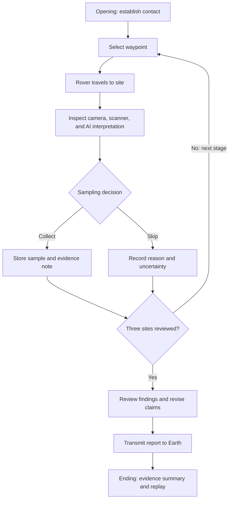

# Project Signal

## Week 1 · Game proposal brief

**Designer:** Jaswenth Sivaraman  
**Theme:** Hallucination  
**Version:** 0.2 · October 28, 2026 · Draft for review  
**Format:** A short 2D browser game, presented first as a proposal webpage on the existing portfolio.

**Working tagline:** Find the evidence. Question the signal.

This document establishes the concept and the work needed for the seven-part Week 1 proposal. It is a planning brief, not the finished proposal submission. The playable game belongs to Weeks 2–3.

## Direction established with Jaswenth

- Project Signal sends a rover to Mars to collect samples and investigate possible microbial life.
- The player navigates using waypoints, inspired by Jaswenth’s experience with driving games such as Beach Buggy Racing.
- A 2D game is sufficient for this assignment.
- Hallucination should emerge from the mission and its interactions.
- Use two complementary game references: We Become What We Behold and Beach Buggy Racing.

The following recommendations remain open to revision: a remote-operator viewpoint, a top-down map, a roughly 3–5 minute session, and three authored investigation sites. The suggested scientific framing is a search for possible microbial traces preserved in material from a formerly wet environment; whether the story emphasizes past or present microbes remains open.

## 01 · Introduce the game

### Pitch

Project Signal is a 2D exploration game about a Mars rover searching for clues of possible microbial life. As its remote operator, the player selects waypoints, investigates sampling sites, and sends findings to Earth. When damaged sensor data reaches the rover’s onboard AI, the system fills in missing information with convincing predictions. Some of those predictions appear to show the discovery the mission hopes to make.

The player must compare observations with AI interpretations, decide what is worth sampling, and report what remains uncertain. Success means bringing back useful evidence without turning a promising clue into an unsupported claim.

### Player experience

The intended progression is **curiosity → confidence → doubt → careful investigation**. Navigation introduces the experience; interpreting what the rover finds gives each journey a purpose.

### Representative visual to create

Show a small rover approaching a sampling waypoint in a rust-colored landscape. An inspection panel presents the same surface in two forms: a rough camera image and an AI-enhanced image suggesting colony-like patterns. A visible disagreement between the images communicates the central question before visitors read the description.

**Status:** Visual direction specified; representative artwork still to be created and credited. Any generated image must be identified as concept artwork, not actual Mars evidence.

## 02 · Present the case study

### Primary browser-game case study

**[We Become What We Behold](https://ncase.itch.io/wbwwb), by Nicky Case.** The creator’s page identifies it as an HTML5 game using mouse input, with a session lasting a few minutes. It also links source code and additional asset credits.

**Reason to investigate:** Study how a simple selection interaction changes the player’s interpretation of events, and how feedback develops across a short experience. These are research questions for play, not claims about Jaswenth’s experience.

**Status:** Selected by Jaswenth. Personal play observations have not yet been documented. This game will carry the required browser-game case study, including the three meaningful moments, five action events, and critical AI discussion.

### Supporting driving-game reference

**[Beach Buggy Racing](https://www.vectorunit.com/beach-buggy-racing/), by Vector Unit.** Jaswenth confirmed this is the driving game he has played. The developer’s official page describes a kart-racing game with tracks, obstacles, powerups, and shortcuts.

**Reason to investigate:** Use Jaswenth’s experience to examine route readability, steering feedback, the feeling of movement, and how the game helps players anticipate what lies ahead. Ask which of these qualities should carry into a slower 2D rover journey. Specific remembered moments still need to be recorded.

Beach Buggy Racing supplies a supporting movement reference. The proposed click-to-waypoint control is Project Signal’s adaptation; this brief does not claim Beach Buggy Racing uses that control scheme. The browser-game requirement will be addressed through We Become What We Behold.

### How the two references inform one game

| Reference | What we will study | Proposed adaptation for Project Signal |
| --- | --- | --- |
| We Become What We Behold | Selection, feedback, interpretation, and narrative progression. | Let inspection choices reveal how the rover’s interpretation differs from its evidence. |
| Beach Buggy Racing | Route clarity, movement feedback, obstacles, and anticipation. | Make destinations and travel readable on a small 2D map, with deliberate movement between investigation sites. |

These adaptations are design hypotheses to review against actual observations. The scope remains one 2D game with the same waypoint–inspection–sampling loop and three authored stages.

### Evidence needed for the proposal

Play We Become What We Behold before reading AI interpretations. Save a first impression, then document:

- **At least three meaningful moments:** what you saw/heard, what you expected, what you did, what changed, and what you understood afterward. Include screenshots or specific notes.
- **At least five player-action events:** player action → game response → player understanding.
- **Creator research:** title, creator/team, official playable link, source links, and relevant art, writing, sound, and interaction credits.
- **Design lesson:** explain which observation will influence Project Signal and what will be adapted.

Keep creator statements, personal observations, and interpretations clearly distinguishable. Neither the moments nor the event table should be filled with imagined play experiences.

For the shorter Beach Buggy Racing reference, record the platform played, specific remembered or replayed driving moments, and a concise explanation of what to adapt. Credit the developer and any selected screenshots. Revisit a race if memories need checking; a second full case study is optional.

## 03 · Document critical discussion with AI

### Research already informing this brief

- **Waypoint navigation:** JPL describes rover planners selecting waypoints and autonomous navigation assessing terrain hazards. This supports the navigation inspiration. It does not establish the fictional hallucination mechanism. [JPL: Surface System Software and Rover Navigation](https://robotics.jpl.nasa.gov/what-we-do/flight-projects/mars-science-laboratory/surface-system-software-and-rover-navigation/)
- **Sample investigation:** NASA describes Perseverance searching deposits that could preserve signs of ancient microbial life, and caching samples for possible future return. This informs the mission’s emphasis on context and careful sampling. [NASA: Perseverance Science Objectives](https://science.nasa.gov/mission/mars-2020-perseverance/science-objectives/)
- **Clues versus proof:** NASA explains that a potential biosignature can have biological or non-biological explanations. The game should distinguish a measured feature from a conclusion about life. [NASA: Rock Sampled by Perseverance](https://www.nasa.gov/missions/mars-2020-perseverance/perseverance-rover/rock-sampled-by-nasas-perseverance-embodies-why-rover-came-to-mars/)

### Discussion still required

After playing We Become What We Behold, give AI the observations and verified creator sources. Review its analysis and identify **at least two actual gaps**. The driving comparison may enrich this discussion, while the primary case study retains the full evidence requirements. Possible questions to investigate include:

1. **Evidence:** Has AI attributed an intention to the creator without a supporting source?
2. **Interaction or sensation:** Has AI overlooked an observed response, silence, delay, or visual change that alters the meaning of an action?

These are investigation prompts, not gaps already established. Save a short genuine exchange showing the original claim, Jaswenth’s challenge using evidence, and the revised interpretation. End with Jaswenth’s own conclusion and a specific design decision for Project Signal.

Our concept conversation has already narrowed the mission to possible microbial life and confirmed a 2D direction. That decision history can accompany the proposal, but it does not replace critical discussion of the chosen case-study game.

**Provisional design decision:** Always let players access the evidence behind a confident AI interpretation. Confirm or revise this after the case study.

## 04 · Narrative and Hallucination concept

### World and player role

In a fictional future mission, Project Signal sends a rover to investigate three sites in an ancient Martian basin. The player operates through a compact mission console: a terrain map, camera view, simplified scanner readings, and sample log.

The original idea of collecting “mud” becomes collecting soil and sediment samples from a formerly wet environment. Fresh wet mud is not assumed. Photographs, measurements, and the report transmit to Earth; physical samples remain stored for later retrieval within the fictional mission.

### What Hallucination means here

Interference leaves gaps in the rover’s sensor feed. Its onboard AI reconstructs missing detail using learned patterns. It begins presenting plausible predictions as if they were direct observations: a mineral texture becomes a colony-like form, or dry ground appears wet in an enhanced image.

**The rover starts seeing the Mars the mission hopes to find.**

This is an invented machine-perception failure used as a narrative mechanic. The story does not claim that real Mars rovers behave this way.

### How the theme becomes playable

- A predicted waypoint looks promising, but its supporting measurements are incomplete.
- Camera data and the AI enhancement disagree about a surface feature.
- A confident “possible biological activity” interpretation has weaker evidence than its wording suggests.
- A real unusual sample remains worth investigating even after the player discovers an earlier false interpretation.

The player learns to question confidence without rejecting every finding. Source labels, readable comparison views, and feedback provide fair clues. The tension should come from interpreting available evidence rather than guessing which interface element is lying.

## 05 · Interaction and player journey

### Main interaction

**Select a waypoint → travel → inspect evidence → collect or skip → record a conclusion.**

Mouse clicks and touch select destinations and inspection controls. Keyboard users can focus and activate the same controls. The proposed game uses a small top-down map with short rover movements and an inspection panel at each site.

### Opening, three stages, and ending

| Part | Player action | Game response | What develops |
| --- | --- | --- | --- |
| Opening — Establish Contact | Connect to the rover and choose the first waypoint. | Mission objective, route marker, and movement demonstration appear. | Learn the controls and sampling purpose. |
| Stage 1 — Baseline | Visit a clear site, compare camera and scanner, and collect a reference sample. | Observations agree; the sample log records its location and evidence. | Establish how dependable readings look. |
| Stage 2 — The Promising Signal | Inspect a site whose enhanced image suggests a wet or colony-like surface; request the raw view. | Raw imagery and scanner readings fail to support the confident interpretation. The player can skip or collect with an uncertainty note. | Discover that an AI interpretation can exceed its evidence. |
| Stage 3 — An Uncertain Discovery | Investigate a new anomaly and compare all available evidence before deciding. | A measurable unusual feature remains, although its biological origin is unresolved. | Distinguish a useful research lead from proof of life. |
| Ending — Signal Home | Review each site, correct unsupported claims, and transmit the report. | The report shows observations, interpretations, uncertainties, and samples retained. | End with an accountable scientific record. |

Visit three sites; collecting three samples is not a mandatory win condition. The proposed ending evaluates how well claims match evidence, with an option to revise the report or replay. Exact feedback wording will be tested.

### Draft flowchart

### Storyboard plan

These are frame specifications; drawn storyboard panels are still needed for the proposal page.

| Frame | Composition and goal | Input | Feedback and continuation |
| --- | --- | --- | --- |
| 1. Contact | Rover silhouette, quiet terrain, mission objective. | Activate “Establish contact.” | Console opens and highlights the first waypoint. |
| 2. Baseline | Rover beside a sediment patch; two agreeing readings. | Select waypoint, inspect, collect. | Sample enters the log; next route becomes available. |
| 3. Contradiction | Enhanced colony-like pattern beside less convincing raw imagery. | Open raw view and compare scanner. | Disagreement becomes visible; record a sampling decision and continue. |
| 4. Reconsider | New rock feature with a real measurable anomaly. | Inspect the evidence and choose whether to collect. | Log separates the observed feature from the uncertain biological explanation. |
| 5. Transmission | Three site records and a report preview. | Review conclusions and transmit. | Evidence summary appears with revise/replay options. |

## 06 · Style and sound guide

### Proposed direction

| Element | Direction | Purpose |
| --- | --- | --- |
| Imagery | Simple 2D terrain, readable rover silhouette, selected inspection close-ups. | Keep navigation clear and focus detail where evidence matters. |
| Color | Rust and muted sand for terrain; cream panels, dark text, cyan waypoints. | Separate landscape, information, and actions. Use labels and shapes alongside color. |
| Typography | Retain the portfolio’s Funnel Display for proposal headings; use clear text and restrained monospaced labels for readings. | Connect the new project to the portfolio while suggesting a mission console. |
| Interface | Map, inspection panel, sample log, and a visible source label for every reading. | Help players trace an interpretation to its evidence. |
| Motion | Short rover travel, a gentle scan sweep, subtle displacement in AI reconstructions. | Confirm actions and suggest instability without obscuring controls. Respect reduced-motion preferences. |
| Sound | Optional low ambience, wheel/scan cues, and restrained radio interference; brief silence when evidence conflicts. | Establish atmosphere and support feedback. Essential clues also appear visually. |

Sound starts only after the visitor chooses to enable it and has a persistent mute control. Audio is designed for the fiction; it is not presented as a scientifically authentic Mars recording.

### Reference work needed

Prepare a small annotated reference board covering terrain/rover imagery, interface and typography, motion, and sound. For each reference record **creator, exact source link, specific feature studied, intended adaptation, and any usage permission/license needed**. NASA/JPL navigation diagrams are a research starting point; individual images and sound references have not yet been selected or cleared for reuse.

**Status:** Art and audio direction drafted. Credited visual examples, a sound reference, and original concept artwork remain to be selected or produced.

## 07 · Two-week build plan

### Week 2 — Build a playable prototype

1. Build one complete site first: waypoint selection, rover movement, inspection panel, sampling decision, and log entry.
2. Extend that loop into the three authored stages with distinct evidence and feedback.
3. Add the opening, report review, ending, and replay.
4. Integrate the first visual and sound assets; support touch and keyboard use.
5. Publish a playable prototype and verify a full run from opening to ending.

**Scope target:** One small map, three investigation sites, two comparison views, a sample log, one report system, and a roughly 3–5 minute session. Hallucinations use authored content and visual changes; no live AI service is needed.

### Week 3 — Test, refine, and publish

Invite several people to play, aiming for three testers. Observe before explaining the rules. Check whether they can find the first waypoint, recognize the first contradiction, distinguish a measurement from a biological claim, and understand the ending.

Test on a wide screen and phone, with keyboard input, sound muted, and reduced motion. Refine unclear instructions, text size, touch targets, pacing, clues, and feedback. Check restart behavior, assets, navigation, and the complete public game after deployment. Summarize changes based on actual testing.

## Week 1 completion path

1. Review this brief and confirm the proposed player journey.
2. Play and document We Become What We Behold; research its creators and credits. Add a shorter Beach Buggy Racing movement reference using Jaswenth’s own observations.
3. Complete the evidence-based AI discussion and Jaswenth’s own conclusion.
4. Produce the representative visual, drawn storyboard, flowchart, and annotated style/sound references.
5. Build a designed proposal webpage with the seven sections in this order; add a project card to the existing portfolio.
6. Publish, open it as a visitor, and check it on another device. Submit the **direct proposal-page URL** through Canvas’s Website URL option.

Proposed future page: `https://jaswenth.github.io/portfolio-ai/project-signal.html` — a planned address, not a published deliverable yet.

## Review status

| Requirement | Current status |
| --- | --- |
| Working title and player-experience description | Drafted; representative visual pending. |
| Case study: credits, 3 moments, 5 events, learning | We Become What We Behold selected as primary; Beach Buggy Racing confirmed as supporting reference. Play evidence and detailed credits pending. |
| Critical AI discussion: verification, 2 gaps, exchange, conclusion | Mission research linked; case-study discussion pending. |
| Narrative, Hallucination interpretation, player role | Drafted; reference influence to be completed after research. |
| Opening, 3 stages, ending, flowchart, storyboard | Journey and draft flowchart provided; drawn storyboard pending. |
| Annotated style and sound references | Direction drafted; credited reference board pending. |
| Week 2–3 build and testing plan | Drafted. |

The next research step is playing and documenting We Become What We Behold, then recording specific Beach Buggy Racing observations. Jaswenth has reported playing Beach Buggy Racing; detailed personal play evidence for either reference is not yet documented here. No completed testing, published proposal, or confirmed discovery of Martian life is claimed by this brief.

**Assignment source:** [Hallucination — Week 1: Research & Pitch, Sections 01–08](https://unibiubiu.github.io/videos-and-reading/hallucination-web-game/), reviewed October 28, 2026. Sections 07–08 govern the required webpage content and submission.
